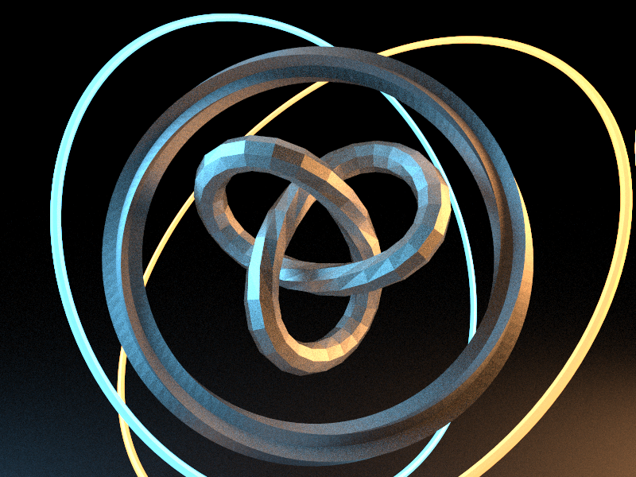
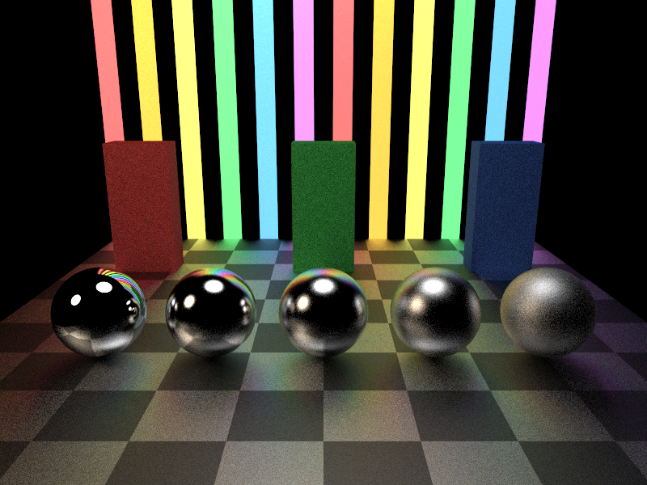
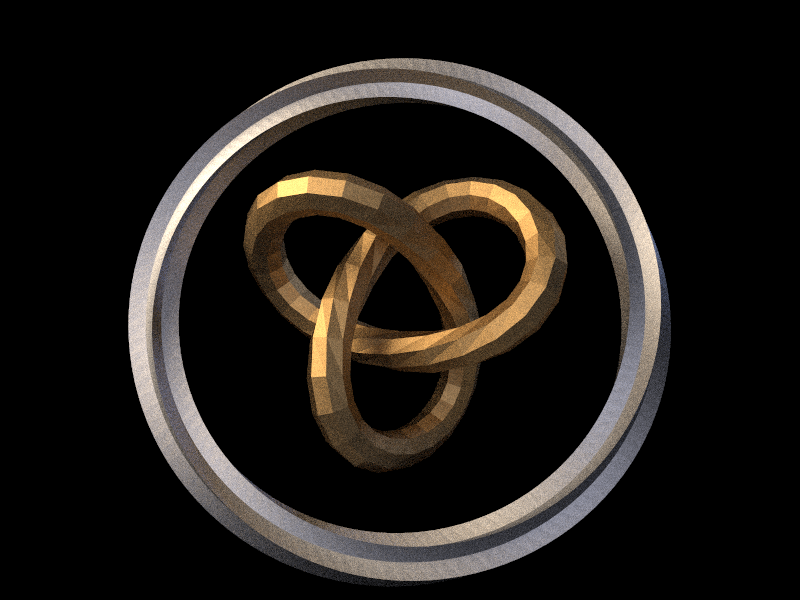

# raytracer

A path tracer written from scratch in C++23. It renders progressively into an SDL2 window: each frame adds one more
sample per pixel, so the image starts out grainy and cleans up as you watch.







## Features

- **Path tracing**: rays start at the camera and bounce around the scene, picking up light from every glowing surface
  they hit, until they escape or reach the bounce limit; each pixel averages many random paths.
- **Shapes**: spheres, triangles and triangle meshes loaded from OBJ files.
- **Two-level BVH**: a bounding volume hierarchy inside every mesh, and another over all objects in the scene. Both
  are the same generic `BVH<T>` template, built top-down by splitting at the median along the longest axis.
- **Ray–triangle intersection** with the Möller–Trumbore method.
- **Materials**: colour, roughness (from mirror-sharp to blurry reflections) and emission. Lights are ordinary objects
  whose material emits, so any shape, including a mesh, can be a light.
- **Multithreaded rendering**, anti-aliasing (each sample is jittered inside its pixel) and gamma correction.
- **Scenes**: each scene is a function that returns a world together with the camera it was laid out for.

The window title shows the frame rate and the number of samples accumulated so far.

## Building

Requirements: CMake 3.20 or newer, a C++23 compiler, SDL2 and GLM.

```sh
# macOS
brew install cmake sdl2 glm

# Ubuntu / Debian
sudo apt install cmake libsdl2-dev libglm-dev

cmake -B build -DCMAKE_BUILD_TYPE=Release
cmake --build build
./build/raytracer
```

Use a Release build: a debug build is many times slower.

To render a different scene, change which `build...Scene()` call is active at the top of `main()` in
[`src/main.cpp`](src/main.cpp). The scenes themselves are in [`src/scene.cpp`](src/scene.cpp).

## Models

The OBJ files in [`models/`](models) are procedural: the trefoil knot, the twisted star ring, the seashell, the orbit
rings and the shrine pieces were each generated from their mathematical description by small Python scripts.
Those scripts were written by Claude during development and are not part of this repository.

## License

MIT, see [LICENSE](LICENSE).
